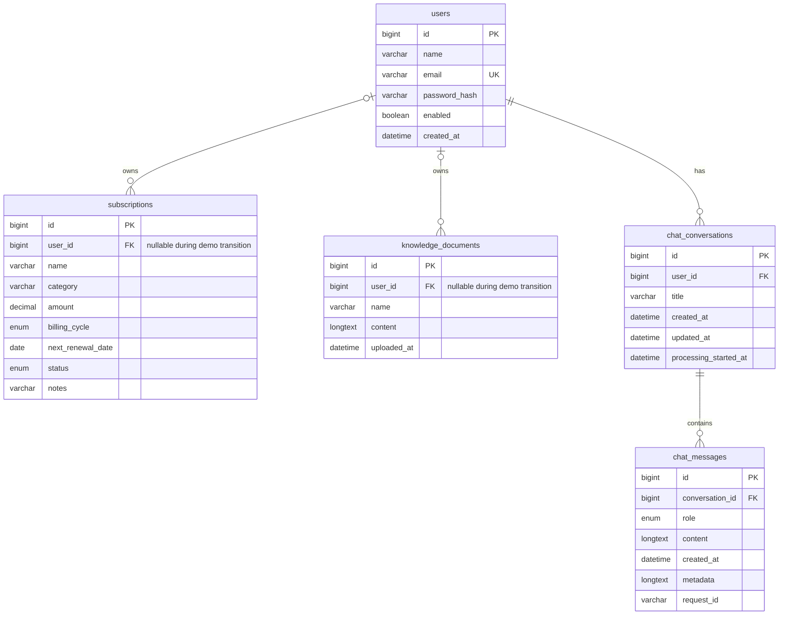

# RenewIQ database

Database/schema: `renewiq_db`, MySQL 8.0. Seven application tables plus Flyway's internal migration history table.

| Table | Primary key | Foreign keys | Purpose / current usage |
| --- | --- | --- | --- |
| `users` | `id` | None | Real signup/login accounts with BCrypt password hashes |
| `payments` | `id` | `user_id` → `users.id` | Immutable snapshots recorded when an owner marks a renewal paid |
| `renewal_email_deliveries` | `id` | `subscription_id` → `subscriptions.id` | Successful SMTP submissions; unique per renewal date and 7/3/1-day threshold |
| `subscriptions` | `id` | `user_id` → `users.id` | Used by subscriptions, dashboard, and assistant tools |
| `knowledge_documents` | `id` | `user_id` → `users.id` | Uploaded text and metadata used by document RAG |
| `chat_conversations` | `id` | `user_id` → `users.id` | Saved chat titles, ownership, creation/update times, and reply-in-progress timestamp |
| `chat_messages` | `id` | `conversation_id` → `chat_conversations.id` | Saved user/assistant messages, JSON metadata snapshots, and deduplication request IDs |

All IDs are auto-incrementing signed BIGINT values. User emails have a unique constraint under a case-insensitive collation. `enabled` defaults to false for direct SQL inserts; signup explicitly enables accounts after creating a BCrypt password hash. `password_hash` is nullable for disabled, not-yet-provisioned accounts; enabled accounts require a non-null hash. Authentication normalizes emails, validates input, verifies password hashes, and persists identity in an HttpOnly server session. Sessions are in server memory, not a database table. Never store plaintext passwords.

Subscription amounts cannot be negative. `billing_cycle` accepts MONTHLY, QUARTERLY, WEEKLY, YEARLY; `status` accepts ACTIVE, PAUSED, CANCELLED. Message roles accept USER or ASSISTANT.

Deleting a user with owned records is restricted. Deleting a conversation cascades to its messages. The application must still check authenticated ownership before any operation; foreign keys alone do not provide access control.

`user_id` on existing subscriptions/documents is deliberately nullable to preserve legacy unassigned data. The authenticated application assigns the current user on every new insert and filters every query by that user. Legacy NULL-owner rows are invisible to all accounts until their owner is verified and individually assigned. No demo fixtures are automatically seeded. Make these foreign keys NOT NULL in a future migration after resolving all legacy rows. Conversation ownership is required from the start. Browser localStorage identity is no longer used for authentication.

No category table is needed for the current free-text category field. Billing cycles/statuses are enums, dashboard totals are calculated, and RAG chunks are produced on retrieval; these do not require extra tables. Add audit tables when that feature is implemented. Updating a tracked subscription status does not cancel an external service or prove a real payment occurred.

V4 (`V4__payment_history.sql`) adds `payments`, with a unique `(subscription_id, renewal_date)` constraint and a nonnegative amount check. `user_id` is required and references the owner; all History queries filter by the authenticated user. `subscription_id` is a historical ID without a foreign key so deleting a subscription preserves payment snapshots. Name, category, amount, currency, billing cycle and renewal date are copied at payment recording, with `paid_at` stored in UTC. Recording the payment and advancing renewal commit or roll back together. There is no automatic provider/bank reconciliation and no synthetic backfill. Apply all Flyway migrations for the complete schema; the schema-only reference export predates V3/V4.

V3 (`V3__renewal_email_deliveries.sql`) adds successful renewal-email delivery tracking. Each row belongs to a subscription and is unique on `(subscription_id, renewal_date, days_before)`; `days_before` accepts 7, 3 or 1. Subscription deletion cascades to these delivery records. Failed SMTP attempts are not recorded as sent. The bell API computes upcoming reminders from current owner-scoped subscriptions, so it does not depend on SMTP delivery or persisted email history. The schema reference export below predates V3; apply all Flyway migrations for the complete schema.

V5 (`V5__immediate_renewal_reminders.sql`) expands `chk_renewal_email_days` to accept 0 through 7. Newly created active subscriptions renewing within that window receive an immediate SMTP attempt. The existing unique key also deduplicates an immediate email against the same day's scheduled 7/3/1 reminder. Existing delivery records are preserved. Apply V5 before using the new backend; Hibernate's test schema does not exercise the MySQL check-constraint migration.

## Migrations and viewing the schema

The source of truth is `backend/src/main/resources/db/migration/V1__application_tables_and_relationships.sql`. Spring Boot runs Flyway before Hibernate validates the entity mappings. Existing nonempty databases are baselined at version 0, then V1 adds tables and relationships without dropping existing rows. Empty databases also work. Later changes must use new V2, V3, etc. migrations; do not edit an applied migration or re-run V1 by hand.

Run the backend once with `.\start-backend.ps1` from the project root. In MySQL Workbench refresh Schemas → `renewiq_db` → Tables. Execute `database/inspect.sql` to view all keys and delete rules. `database/schema.sql` is a schema-only reference export, not an upgrade or bootstrap script. Create new application databases by starting the backend against an empty database so Flyway owns the complete history.

`verify-constraints.sql` exercises foreign-key rejection, unique email, nonnegative amounts, password-presence checks, and message cascade deletion inside a rolled-back transaction. Pipe the file into MySQL CLI standard input with `--force` so its seven deliberately failing statements do not interrupt the final rollback (do not execute it through `source`). Auto-increment counters can advance despite rollback.

The local pre-migration backup is `database/backups/before-relations.sql` and is ignored by Git because it contains application data. The existing root `renewiq_backup.sql` predates this schema and contains a DROP TABLE statement; do not import it over the migrated database.

V2 (`V2__persistent_chat_details.sql`) adds chat update/processing timestamps and message metadata/request IDs without deleting existing records. The unique `(conversation_id, request_id)` constraint deduplicates sent turns. `metadata` stores server-generated JSON for charts, source excerpts, attachment names, error flags, and action state. The app stores user text before the provider call and commits the assistant result separately. The pre-V2 backup is `database/backups/before-chat-persistence.sql`. The refreshed `database/schema.sql` includes V2 columns.
